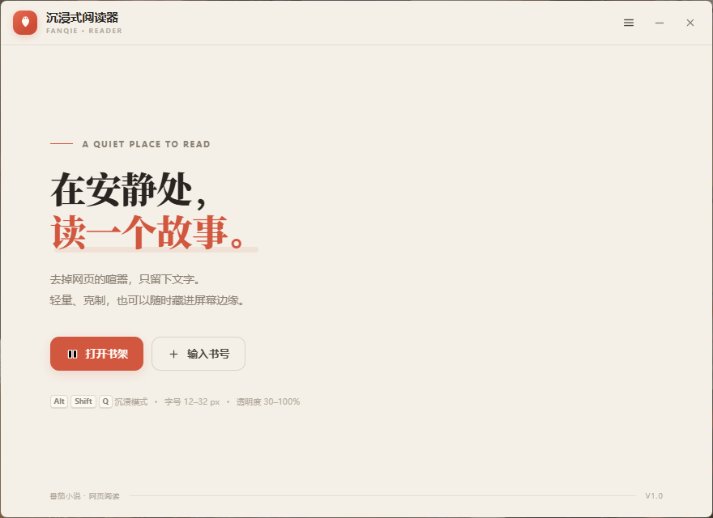
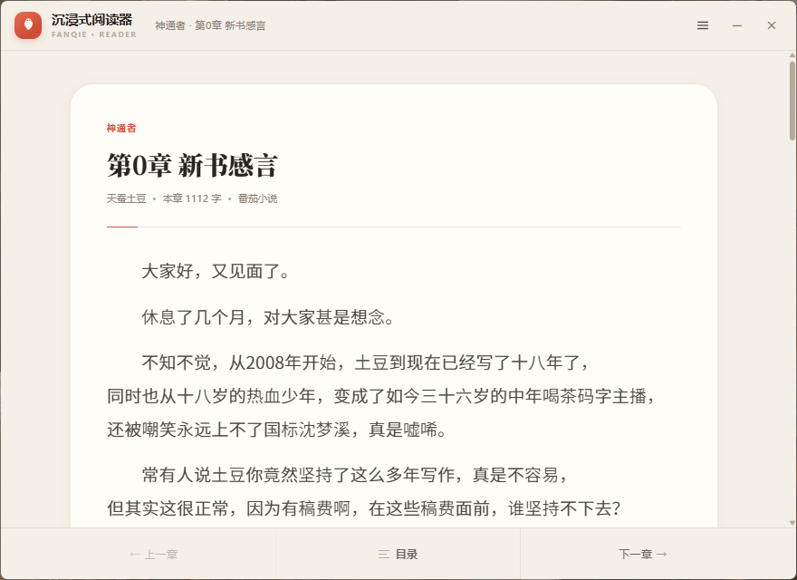
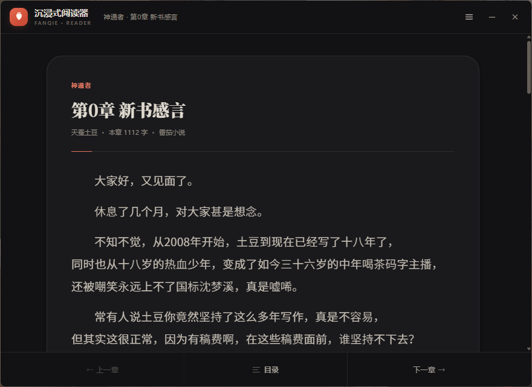
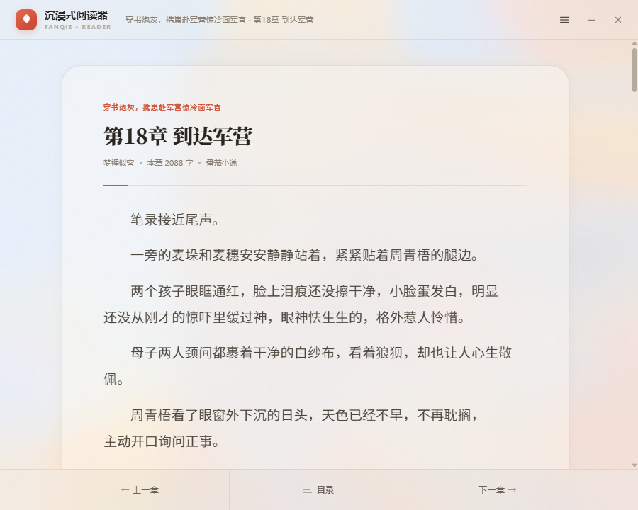
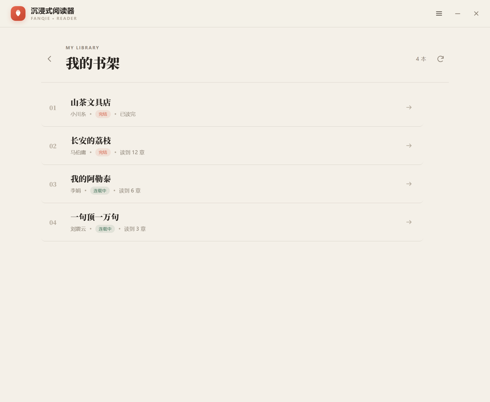
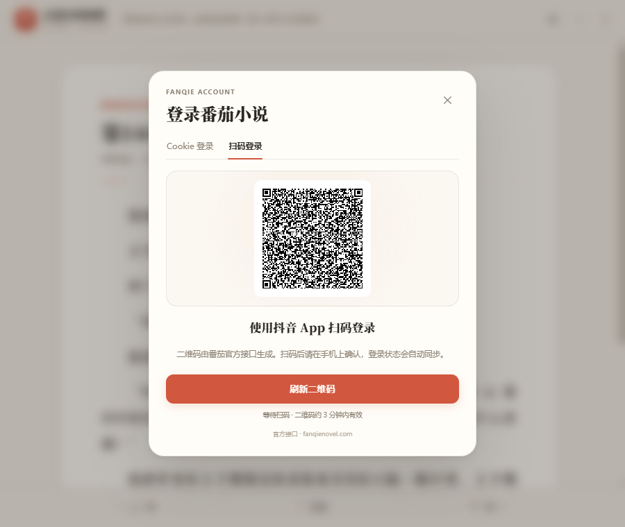

# 番茄沉浸阅读器

> 一个把番茄小说网页版（fanqienovel.com）重新排成"安静阅读版式"的 Windows 桌面阅读器。


[](https://github.com/ms12138/fanqienovel-immersive-reader/actions/workflows/build.yml)
[](LICENSE)

它不是把网页整个塞进窗口，而是提取书名、章节、目录和正文，重新排成安静的阅读版式：米白纸张、克制的珊瑚红、无边框窗口、真透明玻璃，以及一个会自动隐到屏幕边缘的窗口。



> ### ⚠️ 非官方声明
> 本项目是**个人开发的第三方非官方工具**，与番茄小说、抖音、字节跳动及其关联公司**没有任何关系**，也未获得其授权、认可或赞助。
> 项目不提供、不分发、不破解任何小说内容：所有文字都由使用者在自己的账号下、通过官方网页正常访问得到，阅读器只负责重新排版。
> 请遵守番茄小说的用户协议与著作权要求，**仅用于个人学习与技术研究**，不要用于传播、复制、二次分发受版权保护的内容。

## 目录

- [功能](#功能)
- [截图](#截图)
- [快速开始](#快速开始)
- [登录方式](#登录方式)
- [使用小贴士](#使用小贴士)
- [技术实现](#技术实现)
- [从源码构建](#从源码构建)
- [项目结构](#项目结构)
- [数据位置](#数据位置)
- [常见问题](#常见问题)
- [已知限制](#已知限制)
- [免责声明](#免责声明)
- [许可证](#许可证)

## 功能

**阅读**

- 提取正文重新排版，只保留段落纯文本（`textContent` 渲染，不执行页面脚本、不注入 HTML）
- 长章节滚动阅读，顶部显示阅读进度
- 字号 12–32px，日间 / 夜间两套主题，菜单、目录、弹窗同步切换
- 目录抽屉、上一章 / 下一章、沉浸模式（只留正文，`Alt + Shift + Q` 全局开关）

**窗口**

- 无边框窗口，自绘标题栏，脚本驱动拖动（不触发系统贴边预览框）
- **真透明**：`SetWindowCompositionAttribute` 无色亚克力 + 透明 WebView2，滑块 30–100% 实时生效，100% 时完全不透明
- **贴边隐藏**：拖到左/右/上边缘 26px 内自动吸附，鼠标离开 0.4 秒滑出屏幕只留 5px 感应条，移过去滑回，缓动动画
- 窗口位置、主题、字号、透明度、贴边开关全部持久化

**账号**

- Cookie 登录（请求头 / `document.cookie` / 扩展导出的 JSON 都认）
- 二维码登录（调用番茄 passport 接口，抖音 App 扫码确认）
- 书架：书名、作者、连载/完结、总章数、"读到第 N 章"，点书名直接续读到上次的章节

**其它**

- 正文动态字体：按页面真实的 `@font-face` 下载章节字体，并用同款设计的中文字体兜底，避免一个字粗一个字细的混排

## 截图

| 日间阅读 | 夜间阅读 |
| --- | --- |
|  |  |

| 30% 真透明 | 书架 |
| --- | --- |
|  |  |

| 二维码登录 |
| --- |
|  |

## 快速开始

1. 解压整个文件夹（**不要只复制 exe**）。
2. 双击 `番茄沉浸阅读器.exe`。
3. 如果提示缺少 WebView2，请安装 [Microsoft Edge WebView2 Runtime](https://developer.microsoft.com/microsoft-edge/webview2/)（Windows 10/11 通常已自带）。

> 不想自己编译的话，可以直接到 [Releases](https://github.com/ms12138/fanqienovel-immersive-reader/releases) 下载打包好的 `fanqienovel-immersive-reader-*-win-x64.zip`，解压即用。

首次启动显示欢迎页；如果在番茄网页登录过，阅读器会复用本机 WebView2 的 Cookie。

> 便携版没有做商业代码签名，Windows SmartScreen 可能提示"Windows 已保护你的电脑"。确认来源可信后选择"更多信息 → 仍要运行"即可。
>
> 请把整个文件夹解压到桌面或文档等普通用户目录再运行，不要在压缩包里直接双击；也不要同时开两个阅读器窗口（WebView2 的登录配置同一时间只能被一个实例使用）。

## 登录方式

**Cookie 登录（推荐）**

1. 浏览器登录 <https://fanqienovel.com>。
2. 打开开发者工具 → 网络（Network）→ 任意一个番茄请求 → 复制请求头里的整段 `Cookie`。
3. 阅读器菜单 → 登录 → Cookie 登录 → 粘贴 → 登录。

支持三种输入：

- 请求头形式：`sessionid=...; passport_csrf_token=...`
- `document.cookie` 形式
- 浏览器扩展导出的 JSON 数组

> `document.cookie` 看不到 HttpOnly 的 `sessionid`，更稳妥的是复制网络请求的完整 Cookie 请求头。

**二维码登录**

菜单里点"二维码登录"，直接显示番茄官方接口返回的二维码，用抖音 App 扫码并确认；阅读器会自动轮询登录状态并同步 Cookie。

Cookie 不会写进设置文件，而是保存在 WebView2 自己的配置目录里；退出登录会清空番茄相关 Cookie。

## 使用小贴士

- `Alt + Shift + Q`：全局开关沉浸式阅读
- `Esc`：依次关闭弹窗 / 目录 / 菜单；没有浮层时退出沉浸模式
- `[` / `]`（或 `Ctrl` + `-` / `Ctrl` + `=`）：调字号
- `←` / `→`：上一章 / 下一章（输入框聚焦时不生效）
- 贴边隐藏：窗口拖到屏幕边缘附近（差 26px 以内）松手即自动吸附；鼠标离开约 0.4 秒滑出，只留 5px 感应条
- 想临时关掉透明玻璃（录屏、远程桌面），用 `番茄沉浸阅读器.exe --no-glass` 启动

## 技术实现

| 层 | 做法 |
| --- | --- |
| 外壳 | .NET 9 + WPF，无边框窗口，`WindowChrome` 去系统边框，脚本拖动 + `SetWindowPos` |
| 浏览器 | WebView2 加载本地 `WebAssets`（映射到虚拟域名 `https://fanqie.reader/`），JS ↔ C# 走 `postWebMessageAsJson` |
| 透明度 | `SetWindowCompositionAttribute(ACCENT_ENABLE_ACRYLICBLURBEHIND)` 挂一层近乎无色的系统亚克力，WebView2 与页面背景全透明，只有纸面 / 标题栏 / 面板各自带 alpha（每层只叠一次） |
| 贴边隐藏 | 45ms 轮询光标 + 工作区边缘判定，15ms 缓动动画驱动 `SetWindowPos`，外部移动会自动复位 |
| 抓取 | `HttpClient` 带 WebView2 的 Cookie，请求章节页 / 目录页 HTML，AngleSharp 解析；不注入任何远程脚本 |
| 字体 | 解析页面 `<style>` 里的 `@font-face`（家族名、字重 400、woff2/woff/otf 多 CDN 回退），转 data URL 注入，兜底字体与章节字体同风格 |

更细的内部说明见 [PROJECT_CONTEXT.md](PROJECT_CONTEXT.md)。

## 从源码构建

环境：Windows 10/11 x64、[.NET 9 SDK](https://dotnet.microsoft.com/download)、WebView2 Runtime。

```powershell
git clone https://github.com/ms12138/fanqienovel-immersive-reader.git
cd fanqienovel-immersive-reader/app/FanqieReader
dotnet restore
dotnet run
```

发布自包含便携版（目标机器无需安装 .NET）：

```powershell
dotnet publish -c Release -r win-x64 --self-contained true `
  -p:PublishSingleFile=false -p:PublishTrimmed=false `
  -o ..\..\dist\番茄沉浸阅读器
```

### 自动构建

仓库带了一条 GitHub Actions 工作流（`.github/workflows/build.yml`），在 `windows-latest` 上：

- **每次 push / PR**：`node --check` 校验前端脚本 → `dotnet restore / build` → 自包含 `publish` → 校验产物完整性 → 打包 zip → 上传为构建产物
- **打 `v*` 标签**：额外创建 GitHub Release 并附上 zip（例如 `git tag v1.0.1 && git push origin v1.0.1`）

想拿最新构建（不需要等发版）：仓库 **Actions → build → 最近一次运行 → Artifacts** 下载 `fanqienovel-immersive-reader-win-x64` 即可，产物保留 14 天。

## 项目结构

```text
fanqienovel-immersive-reader/
├─ app/FanqieReader/          WPF + WebView2 应用
│  ├─ WebAssets/              阅读器 UI（HTML / CSS / JS）
│  ├─ Services/               登录、抓取、解析、贴边、热键
│  ├─ Models/                 数据模型
│  └─ MainWindow.xaml.cs      窗口、桥接、透明玻璃、状态
├─ screenshots/               README 截图
├─ PROJECT_CONTEXT.md         实现细节与排坑记录
└─ README.md
```

## 数据位置

- 设置：`%APPDATA%\FanqieReader\settings.json`
- WebView2 配置与登录态：`%LOCALAPPDATA%\FanqieReader\WebView2`
- 运行日志：`%LOCALAPPDATA%\FanqieReader\logs\reader.log`（排查启动 / 网络问题用）
- 二维码与正文请求不写入磁盘；字体只做内存缓存

## 常见问题

**打开时提示「无法启动内嵌浏览器（WebView2）」/「请求的资源在使用中」(0x800700AA)**

登录态存在 WebView2 自己的配置目录里。上一次异常退出、或另一个阅读器实例还在跑时，这个目录会被占用。
新版会自动依次尝试 `...\WebView2`、`WebView2-2`、`WebView2-3`…，换了目录后**需要重新登录一次**；每一步都记录在
`%LOCALAPPDATA%\FanqieReader\logs\reader.log`。

**想做成真正的便携版（配置跟着文件夹走）**

```powershell
番茄沉浸阅读器.exe --profile-dir "D:\FanqieProfile"
```

登录配置和日志都会放到指定目录，整个文件夹可以随身带走。

**书架的作者 / 阅读进度不对**

阅读器会把这一轮书架接口的原始应答写到 `%LOCALAPPDATA%\FanqieReader\logs\shelf-dump.json`。
这类字段名随官方改版变化，遇到问题把这个文件连同日志一起发出来即可定位。

## 已知限制

- **复制出来的正文可能有错字**：番茄正文使用动态字体反爬，一部分字符被替换成私用区码位，只靠章节字体还原。阅读器保证"看得见、排版正常"，但复制 / 搜索拿到的是映射后的码位。
- 书架接口依赖登录态与参数（`aid=1967`），官方改版可能失效；接口失败时书架页会直接显示原因。
- 未登录时只能看到试读片段，登录已购 / SVIP 账号后能读到的范围取决于官方网页返回的内容。
- 真透明依赖系统亚克力：Windows 10 1803+ / Windows 11 可用，更旧的系统上窗口保持不透明，可用 `--no-glass` 强制关闭。
- 没有做自动更新、代理、下载、离线缓存。

## 免责声明

- 本项目为非官方第三方工具，与番茄小说、抖音、字节跳动及其关联公司无任何关联。
- 项目不存储、不分发任何小说内容，也不提供绕过付费 / 会员限制的能力；能读到什么完全由使用者自己的官方账号权限决定。
- 正文、字体等**内容**的著作权归原作者及平台所有，不在本项目的许可证范围内。请遵守《番茄小说用户协议》与相关法律法规，仅供个人学习与技术研究使用，不要传播或再分发受版权保护的内容。
- 使用本工具产生的任何后果（包括但不限于账号异常、数据丢失）由使用者自行承担。
- 如果你是权利方并认为本项目不妥，请通过 Issue 联系，我会配合调整或移除相关内容。

## 许可证

本项目以 **GNU General Public License v3.0** 发布，全文见 [LICENSE](LICENSE)。

- 你可以自由使用、修改、分发本项目代码；分发时需同样以 GPLv3 开源并提供源码。
- 许可证只覆盖**本项目代码**，不覆盖番茄小说的正文、字体、封面等内容，这些内容的权利仍归原作者与平台所有。
- 若修改后分发，请保留非官方声明，避免让他人误以为这是官方或经授权的软件。

## 反馈

欢迎提 Issue 反馈 bug 或建议。提 bug 时附上 `%LOCALAPPDATA%\FanqieReader\logs\reader.log` 中的相关几行会快很多（日志里没有 Cookie）。
